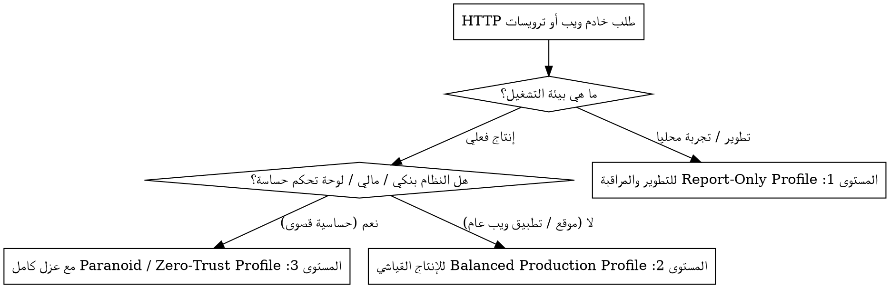

# معيار `Security Headers Core`: المعيار الهندسي للترويسات الأمنية والتحصين السيبراني

دليل هندسي دفاعي لتطبيق الترويسات الأمنية في العمق `(Defense-in-Depth HTTP Security Headers)`، وتأمين سياسات المحتوى `(CSP)`، وعزل المصادر المتقاطعة، وتأمين الجلسات وملفات تعريف الارتباط عبر خوادم الويب وأطر العمل.

## متى تُستخدم هذه المهارة `(When to Use)`



* **استدعاء إلزامي عند**:
  * ضبط أو مراجعة إعدادات خوادم الويب `(Nginx, Caddy, Apache, Cloudflare)`.
  * كتابة أو تدقيق البرمجيات الوسيطة `(Security Middleware)` في أطر العمل `(Next.js, Laravel, Express)`.
  * حماية التطبيق من هجمات الحقن `(XSS)`، وهجمات النقر المخادع `(Clickjacking)`، وتزوير الطلبات `(CSRF)`.
  * تأمين ملفات تعريف الارتباط `(Session & Auth Cookies)` وبادئات العزل.
  * إجراء تدقيق أمني ومطابقة اختبارات `(Mozilla Observatory / SSL Labs / SecurityHeaders.com)`.

---

## مستويات الحماية الثلاثة `(The 3 Security Profiles)`

### 1. وضع المراقبة والتطوير `(Development & Report-Only)`
* **الهدف**: رصد انتهاكات السكربتات دون تعطيل المطور أثناء بناء الميزات.
* **الترويسة الأساسية**:
```http
Content-Security-Policy-Report-Only: default-src 'self'; script-src 'self' 'unsafe-inline' https:; report-uri /api/csp-report;
```

### 2. الإنتاج القياسي المتوازن `(Standard Balanced Production)`
* **الهدف**: حماية قوية وشاملة لمعظم تطبيقات ومواقع الويب الإنتاجية دون تعطيل خدمات الطرف الثالث الشائعة.
* **الترويسات الإلزامية**:
```http
Strict-Transport-Security: max-age=63072000; includeSubDomains; preload
X-Content-Type-Options: nosniff
X-Frame-Options: DENY
Referrer-Policy: strict-origin-when-cross-origin
Permissions-Policy: camera=(), microphone=(), geolocation=(), payment=(), usb=()
Content-Security-Policy: default-src 'self'; base-uri 'self'; font-src 'self' https: data:; form-action 'self'; frame-ancestors 'none'; img-src 'self' data: https:; object-src 'none'; script-src 'self' 'strict-dynamic' https:; style-src 'self' 'unsafe-inline' https:; upgrade-insecure-requests;
```

### 3. الحماية القصوى والأنظمة الحساسة `(Paranoid / Zero-Trust)`
* **الهدف**: المنصات المالية، لوحات التحكم الإدارية، والتطبيقات المشفرة التي تتعامل مع بيانات حرجة.
* **الترويسات الإضافية وعزل المصادر `(Cross-Origin Isolation)`**:
```http
Cross-Origin-Opener-Policy: same-origin
Cross-Origin-Embedder-Policy: require-corp
Cross-Origin-Resource-Policy: same-origin
Clear-Site-Data: "cache", "cookies", "storage"
Cache-Control: no-store, no-cache, must-revalidate, max-age=0
Content-Security-Policy: default-src 'none'; base-uri 'none'; form-action 'self'; frame-ancestors 'none'; object-src 'none'; script-src 'nonce-{RANDOM}' 'strict-dynamic'; require-trusted-types-for 'script'; style-src 'self' 'nonce-{RANDOM}'; font-src 'self'; img-src 'self'; connect-src 'self'; upgrade-insecure-requests;
```

---

## معيار تأمين ملفات الكوكيز `(Cookie Security Standard)`

* **السمات الإلزامية**: كل كوكي جلسة أو مصادقة يجب أن يحمل السمات التالية:
  * خاصية `Secure`: نقل مشفر عبر `HTTPS` حصراً.
  * خاصية `HttpOnly`: منع وصول جافاسكربت لمنع سرقة الـ `Session` عبر ثغرات `XSS`.
  * خاصية `SameSite=Lax` (للمواقع العامة) أو `SameSite=Strict` (للوحات الحساسة).
* **بادئات العزل التلقائي `(Cookie Prefixes)`**:
  * استخدام `__Host-SessionID` بدلاً من `SessionID` العادي؛ حيث تفرض البادئة `__Host-` في المتصفح ألا يُقبل الكوكي إلا إذا كان عبر `HTTPS`، وصادراً من النطاق الأصلي حصراً، ومساره الجذر `/`، مما يمنع النطاقات الفرعية من التلاعب بالجلسات.

---

## جدول المراجع السريعة `(Quick Reference Table)`

| المجال | الملف المرجعي التابع | المحتوى المتاح |
| :--- | :--- | :--- |
| **هندسة `CSP`** | `reference/csp-deep-dive.md` | تفاصيل `Nonces`، و `Hashes`، وحلول تكامل `GTM` و `Stripe` بدون `unsafe-inline` |
| **العزل وتأمين الكوكيز** | `reference/isolation-and-cookies.md` | ترويسات `COOP`، و `COEP`، و `CORP`، وقاموس `Permissions-Policy` وبادئات `__Host-` |
| **قوالب الخوادم والأطر** | `reference/server-configs.md` | تكوينات `Nginx` (حل فخ التوارث)، و `Cloudflare`، و `Caddy`، و `Next.js`، و `Laravel` |

---

## المحظورات الصارمة `(Red Flags - STOP and Fix)`

* ❌ استخدام `'unsafe-inline'` أو `'unsafe-eval'` في كود جافاسكربت الإنتاجي دون استخدام قيم عشوائية `(Nonces)` أو بصمات `(Hashes)`.
* ❌ استخدام علامة النجمة `*` في مصادر السكربتات `script-src` أو الاتصالات `connect-src`.
* ❌ تفعيل خيار `preload` في ترويسة `HSTS` قبل اختبار توفر شهادات `SSL` صالحة على كافة النطاقات الفرعية.
* ❌ استخدام ترويسة `X-Frame-Options: ALLOW-FROM` (مهملة وتتجاهلها المتصفحات الحديثة؛ البديل المعتمد هو `frame-ancestors` في CSP).
* ❌ الاكتفاء بترويسات أمنية وهمية `(Security Theater)` مع ترك كوكيز الجلسة بدون `HttpOnly` و `Secure`.
